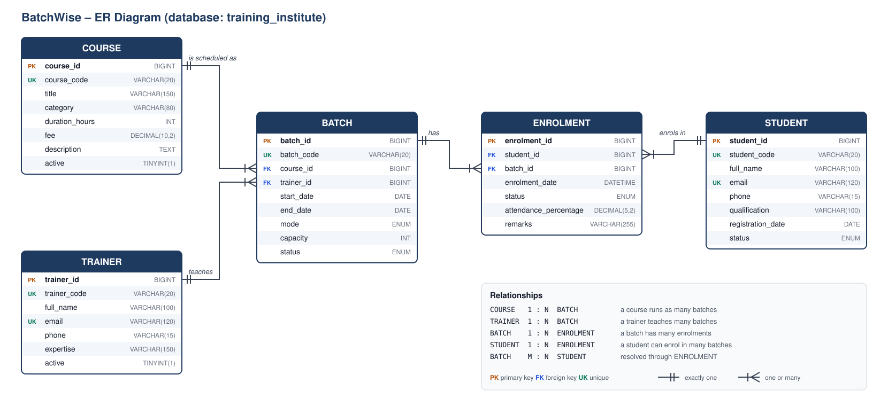

# BatchWise – Training Institute Course & Batch Management System

BatchWise is a full-stack web application for a training institute. Staff use it to maintain the
**course catalogue**, **trainers** and **students**, schedule course **batches**, and **enrol** students
into batches. It enforces capacity limits, prevents duplicate enrolments and never hard-deletes records
that other data depends on.

*Problem statement #5 (Education domain).*

| Layer | Technology |
|---|---|
| Frontend | Angular 22 (standalone components, Router, reactive forms, HttpClient), Bootstrap 5 |
| Backend | Spring Boot 3.5 (Java 17): REST controllers → services → Spring Data JPA repositories |
| Database | MySQL 8 (InnoDB) |

---

## Repository layout

```
.
├── training-institute-api/          Spring Boot REST API
│   ├── pom.xml
│   ├── src/main/java/.../           controller · service · repository · entity · dto · exception · config
│   ├── database/schema.sql          MySQL schema (5 tables, keys and check constraints)
│   ├── database/sample-data.sql     demo data
│   ├── postman/                     Postman collection (47 requests, including business-rule checks)
│   └── README.md                    full API endpoint summary and error format
├── training-institute-ui/           Angular front end
│   ├── package.json
│   ├── src/app/core/                models, HttpClient services, error handling
│   ├── src/app/shared/              reusable components (navbar, tables, badges, confirm dialog …)
│   └── src/app/pages/               dashboard, courses, trainers, students, batches, enrolments
└── docs/
    ├── er-diagram.svg               entity-relationship diagram
    ├── test-cases.md                46 executed API test cases with actual results
    └── run-api-tests.py             script that runs the test cases and regenerates the table
```

---

## How to run

**Prerequisites:** Java 17 or later, MySQL 8, Node.js 22.22 or later with npm. Maven is not needed because the Maven wrapper is included.

### 1. Database
```bash
cd training-institute-api
mysql -u root -p < database/schema.sql
mysql -u root -p training_institute < database/sample-data.sql   # demo data – clears existing rows first
```

### 2. Backend (port 8080)
Give the API your MySQL password. Do this **one** of two ways:
- copy `src/main/resources/application-local.properties.example` to `application-local.properties` and set `spring.datasource.password` (this file is git-ignored), **or**
- set the `DB_PASSWORD` environment variable (`DB_URL` and `DB_USERNAME` are also supported).

```bash
cd training-institute-api
./mvnw spring-boot:run
```
To check it's running, open http://localhost:8080/api/dashboard. It should return JSON.

### 3. Frontend (port 4200)
```bash
cd training-institute-ui
npm install
npm start
```
Then open **http://localhost:4200**.

---

## Data model



| Entity | Key fields | Relationships |
|---|---|---|
| **Course** | `course_code` (unique), title, category, duration_hours, fee, active | 1 course → many batches |
| **Trainer** | `trainer_code` (unique), full_name, `email` (unique), phone, expertise, active | 1 trainer → many batches |
| **Student** | `student_code` (unique), full_name, `email` (unique), phone, qualification, registration_date, status | 1 student → many enrolments |
| **Batch** | `batch_code` (unique), course_id FK, trainer_id FK, start/end date, mode, capacity, status | 1 batch → many enrolments |
| **Enrolment** | student_id FK, batch_id FK, enrolment_date, status, attendance_percentage, remarks | links students and batches (many-to-many) |

---

## Business rules

All rules are enforced in the **service layer** of the API. The UI warns about them before you submit, but the API is what decides.

| Rule | What happens |
|---|---|
| Batch capacity | An `ENROLLED` request into a full batch is rejected with **409**. The student can be added as `WAITLISTED` instead. |
| Seats | Only `ENROLLED` and `COMPLETED` enrolments take a seat. Withdrawing a student frees the seat, and a waitlisted student can then be moved in. |
| No duplicate enrolment | A student can have only one active (`ENROLLED` or `WAITLISTED`) enrolment per batch. A second one gets **409**. |
| No hard delete with dependents | A course, trainer or batch that other records depend on cannot be deleted (**409**). Instead, deactivate the course or trainer, or cancel the batch. |
| Cancelling a batch | All its enrolled and waitlisted students are withdrawn. A `CANCELLED` or `COMPLETED` batch cannot be reopened. |
| Scheduling | Only active courses and trainers can be used. The end date must be on or after the start date. A trainer cannot run two overlapping batches. |
| Eligibility | Only `ACTIVE` students can enrol, and only into `PLANNED` or `RUNNING` batches. |

Errors are returned as JSON with a meaningful status: **400** for validation (one message per field),
**404** when a record isn't found, and **409** when a business rule is broken.

---

## API summary

Base URL: `http://localhost:8080/api`

| Resource | Endpoints |
|---|---|
| Courses | `GET /courses` (`?search=&active=`), `GET /courses/{id}`, `POST /courses`, `PUT /courses/{id}`, `PATCH /courses/{id}/status?active=`, `DELETE /courses/{id}` |
| Trainers | `GET /trainers` (`?search=&active=`), `GET /trainers/{id}`, `POST`, `PUT /{id}`, `PATCH /{id}/status?active=`, `DELETE /{id}` |
| Students | `GET /students` (`?search=&status=`), `GET /students/{id}`, `POST`, `PUT /{id}`, `PATCH /{id}/status?status=`, `DELETE /{id}` |
| Batches | `GET /batches` (`?search=&status=&courseId=&trainerId=`), `GET /batches/{id}`, `GET /batches/{id}/summary`, `POST`, `PUT /{id}`, `PATCH /{id}/status?status=`, `DELETE /{id}` |
| Enrolments | `GET /enrolments` (`?search=&status=&batchId=&studentId=`), `GET /enrolments/{id}`, `POST`, `PUT /{id}`, `PATCH /{id}/status?status=`, `DELETE /{id}` |
| Dashboard | `GET /dashboard` |

Request and response examples are in [training-institute-api/README.md](training-institute-api/README.md) and in the Postman collection.

---

## Testing

- **Postman:** import `training-institute-api/postman/Training-Institute-API.postman_collection.json`. The *Business rule checks* folder shows every rule being rejected with the expected status code.
- **Test-case table:** [docs/test-cases.md](docs/test-cases.md) has **46 cases, all passing**, run against the live API. To re-run them and regenerate the table while the API is running:
  ```bash
  python3 docs/run-api-tests.py
  ```
  The script creates temporary `TC-*` records and deletes them at the end.

---

## Out of scope

As the problem statement specifies, the following are not included: LMS or online content delivery, fee payment, exams, authentication, and AI features.
